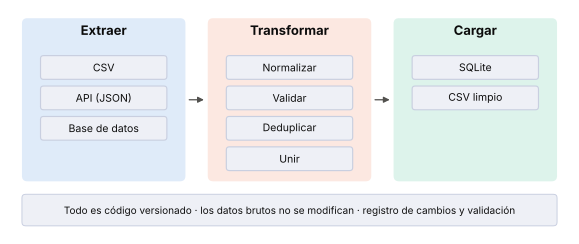

# Capítulo 3. ETL: extraer, transformar y cargar {#sec-cap3}

::: {.callout-note appearance="default"}
## Objetivos
- Diseñar un proceso ETL reproducible para datos de investigación.
- Ordenar los datos según los principios de los datos *tidy*.
- Limpiar problemas típicos (formatos, valores perdidos, duplicados) con Python y R y cargar el resultado en una base de datos.
:::

::: {.callout-note appearance="simple" icon="false"}
## Glosario del capítulo
[ETL](92-glosario.qmd#gl-etl) · [Datos tidy](92-glosario.qmd#gl-tidy) · [Expresión regular](92-glosario.qmd#gl-regex) · [Normalización](92-glosario.qmd#gl-normalizacion) · [Deduplicación](92-glosario.qmd#gl-deduplicacion) · [SQLite](92-glosario.qmd#gl-sqlite) · [Idempotencia](92-glosario.qmd#gl-idempotencia)
:::

::: {.callout-tip appearance="simple" icon="false"}
## Descargas
[Plantilla de entrega del reto (.qmd)](plantillas/entrega_reto.qmd){.btn .btn-outline-primary .btn-sm download="entrega_reto.qmd"}
[Datos del libro (.csv)](datos/publicaciones.csv){.btn .btn-outline-primary .btn-sm download="publicaciones.csv"}
[Muestra de OpenAlex (.json)](datos/openalex_muestra.json){.btn .btn-outline-primary .btn-sm download="openalex_muestra.json"}
:::

## Lectura obligatoria

::: {.lectura}
Wickham, H. (2014). [Tidy data](https://doi.org/10.18637/jss.v059.i10). *Journal of Statistical Software*, 59(10), 1-23.
:::

## 1. Qué es un proceso ETL

**ETL** son las siglas de *extract, transform, load*: **extraer** los datos de sus fuentes (archivos, API, bases de datos, páginas web), **transformarlos** (limpiar, unir, recodificar, calcular) y **cargarlos** en el destino donde se analizarán (una base de datos, un archivo limpio). En investigación, el ETL es a menudo la parte más larga y la que más errores esconde.

{#fig-p3-etl fig-alt="Diagrama de tres bloques. Extraer: CSV, API JSON y base de datos. Transformar: normalizar, validar, deduplicar y unir. Cargar: base de datos SQLite y CSV limpio. Debajo, una banda indica que todo el proceso es código versionado y que los datos brutos no se modifican."}

Principios para un ETL reproducible:

- Los **datos brutos no se tocan**; todo cambio es código.
- Cada paso es una **función** pequeña y probada.
- El proceso es **idempotente**: ejecutarlo dos veces da el mismo resultado.
- Se **registra** qué se ha cambiado (cuántas filas se descartan y por qué).
- Se **valida** al final: tipos, rangos, claves únicas.

## 2. Datos tidy

Wickham (2014) define los **datos tidy** (ordenados) con tres reglas: cada **variable** es una columna, cada **observación** es una fila y cada tipo de unidad observacional es una tabla. Muchos problemas de los datos reales violan esas reglas: varios autores en una celda, años en columnas, unidades mezcladas. En `publicaciones.csv`, la columna `autores` contiene varios valores en una celda; para analizar la autoría habría que **separarla** en una tabla aparte (una fila por artículo y autor).

## 3. Transformar: los problemas típicos

| Problema | Ejemplo en los datos | Solución |
|---|---|---|
| Formatos inconsistentes | `https://doi.org/10…`, `DOI: 10…` | **Normalización** con expresiones regulares |
| Categorías mal escritas | `Sí`, `si`, `TRUE` | Diccionario de recodificación |
| Números como texto | `" 2021"`, `"2021.0"`, `"s.f."` | Conversión con control de errores |
| Valores perdidos | `NA`, `n/d`, vacío | Unificar a un único valor ausente |
| Duplicados | Registros repetidos | **Deduplicación** por clave normalizada |

Una **expresión regular** describe un patrón de texto. Para los DOI, un patrón útil es `10\.\d{4,9}/\S+`: «10.», de cuatro a nueve dígitos, una barra y caracteres sin espacios.

## Laboratorio: prueba expresiones regulares {#lab-p3-regex}

::: {.laboratorio}
::: {.laboratorio-etiqueta}
Laboratorio · se ejecuta en tu navegador
:::

```{ojs}
//| echo: false
texto = window.Lab.texto
area = window.Lab.area
viewof patron = texto("Patrón (sintaxis de JavaScript, muy parecida a la de Python)", {value: "10\\.\\d{4,9}/\\S+"})
viewof muestras = area("Textos de prueba (uno por línea)", {rows: 6, value: "https://doi.org/10.1371/journal.pcbi.1005510\nDOI: 10.18637/JSS.V059.I10\ndoi:10.1038/s41586-020-2649-2.\nsin doi\n10.123/corto\nVer 10.1080/00031305.2017.1375986 (2018)"})
```

```{ojs}
//| echo: false
{
  const d = html`<div role="status"></div>`;
  let re;
  try { re = new RegExp(patron, "i"); } catch (e) { d.innerHTML = `<p class="lab-mal" style="font-weight:600">Patrón no válido: ${String(e.message).replace(/</g, "&lt;")}</p>`; return d; }
  const esc = s => s.replace(/&/g, "&amp;").replace(/</g, "&lt;");
  const filas = muestras.split("\n").filter(l => l.trim()).map(l => { const m = l.match(re); return `<tr><td><code>${esc(l)}</code></td><td>${m ? `<code>${esc(m[0])}</code>` : '<span class="lab-mal">sin coincidencia</span>'}</td><td>${m ? `<code>${esc(m[0].toLowerCase().replace(/[.,;)]+$/, ""))}</code>` : "—"}</td></tr>`; }).join("");
  d.innerHTML = `<table class="table table-sm"><thead><tr><th scope="col">Texto</th><th scope="col">Coincidencia</th><th scope="col">Normalizado (minúsculas, sin puntuación final)</th></tr></thead><tbody>${filas}</tbody></table>
   <p class="small">Fíjate en el tercer ejemplo: el punto final se cuela en la coincidencia. Por eso conviene quitar la puntuación final al normalizar.</p>`;
  return d;
}
```
:::

## Ejercicios

### Ejercicio 3.1 · Normalizar los DOI (Python) {.unnumbered}

Extrae y normaliza los DOI de la columna `doi`. ¿Cuántos DOI **únicos** hay después de normalizar?

```{pyodide}
#| exercise: p3_doi
#| setup: true
import pandas as pd
pub = pd.read_csv("datos/publicaciones.csv", dtype=str)
```

```{pyodide}
#| exercise: p3_doi
doi = (pub["doi"].fillna("")
         .str.extract(r"(10\.\d{4,9}/\S+)", expand=False)
         .str.______()
         .str.rstrip(".,;"))
doi.nunique()
```

::: {.hint exercise="p3_doi"}
Los DOI no distinguen mayúsculas y minúsculas: pásalos todos a minúsculas con `.str.lower()`.
:::

::: {.solution exercise="p3_doi"}
```python
doi = (pub["doi"].fillna("")
         .str.extract(r"(10\.\d{4,9}/\S+)", expand=False)
         .str.lower()
         .str.rstrip(".,;"))
doi.nunique()
```
Sin pasar a minúsculas, algunos DOI escritos en mayúsculas contarían como distintos.
:::

```{pyodide}
#| exercise: p3_doi
#| check: true
import pandas as pd
p = pd.read_csv("datos/publicaciones.csv", dtype=str)
esperado = p["doi"].fillna("").str.extract(r"(10\.\d{4,9}/\S+)", expand=False).str.lower().str.rstrip(".,;").nunique()
if result == esperado:
    feedback = {"correct": True, "message": f"Correcto: {esperado} DOI únicos."}
else:
    feedback = {"correct": False, "message": "Pasa los DOI a minúsculas antes de contarlos."}
feedback
```

### Ejercicio 3.2 · Recodificar el acceso abierto (Python) {.unnumbered}

Convierte la columna `acceso_abierto` en verdadero, falso o ausente con un diccionario, y calcula la **proporción de acceso abierto** entre los registros con valor conocido.

```{pyodide}
#| exercise: p3_oa
#| setup: true
import pandas as pd
pub = pd.read_csv("datos/publicaciones.csv", dtype=str)
```

```{pyodide}
#| exercise: p3_oa
recodifica = {"sí": True, "si": True, "true": True, "no": False, "false": ______}
oa = pub["acceso_abierto"].str.strip().str.lower().map(recodifica)
round(oa.dropna().astype(bool).mean(), 3)
```

::: {.hint exercise="p3_oa"}
«false» significa falso: `False`.
:::

::: {.solution exercise="p3_oa"}
```python
recodifica = {"sí": True, "si": True, "true": True, "no": False, "false": False}
oa = pub["acceso_abierto"].str.strip().str.lower().map(recodifica)
round(oa.dropna().astype(bool).mean(), 3)
```
:::

```{pyodide}
#| exercise: p3_oa
#| check: true
import pandas as pd
p = pd.read_csv("datos/publicaciones.csv", dtype=str)
r = {"sí": True, "si": True, "true": True, "no": False, "false": False}
esperado = round(p["acceso_abierto"].str.strip().str.lower().map(r).dropna().astype(bool).mean(), 3)
if result == esperado:
    feedback = {"correct": True, "message": "Correcto: " + f"{esperado * 100:.1f}".replace(".", ",") + " % en acceso abierto."}
else:
    feedback = {"correct": False, "message": "«false» debe recodificarse como False."}
feedback
```

### Ejercicio 3.3 · Cargar en SQLite (Python) {.unnumbered}

Carga la tabla limpia en una base de datos **SQLite** en memoria y consulta con SQL cuántas publicaciones hay de **2023**.

```{pyodide}
#| exercise: p3_sql
#| setup: true
import pandas as pd, sqlite3
pub = pd.read_csv("datos/publicaciones.csv", dtype=str)
pub["anio"] = pd.to_numeric(pub["anio"].str.strip(), errors="coerce").astype("Int64")
pub = pub.drop_duplicates(subset=["titulo", "autores"])
```

```{pyodide}
#| exercise: p3_sql
con = sqlite3.connect(":memory:")
pub.to_sql("publicaciones", con, index=False)
con.execute("SELECT COUNT(*) FROM publicaciones WHERE anio = ______").fetchone()[0]
```

::: {.hint exercise="p3_sql"}
Escribe el año como número: `2023`.
:::

::: {.solution exercise="p3_sql"}
```python
con = sqlite3.connect(":memory:")
pub.to_sql("publicaciones", con, index=False)
con.execute("SELECT COUNT(*) FROM publicaciones WHERE anio = 2023").fetchone()[0]
```
Los años escritos como `"2023.0"` también se han convertido gracias a `pd.to_numeric`; los `"s.f."` quedan como ausentes.
:::

```{pyodide}
#| exercise: p3_sql
#| check: true
import pandas as pd
p = pd.read_csv("datos/publicaciones.csv", dtype=str)
p["anio"] = pd.to_numeric(p["anio"].str.strip(), errors="coerce")
p = p.drop_duplicates(subset=["titulo", "autores"])
esperado = int((p["anio"] == 2023).sum())
if result == esperado:
    feedback = {"correct": True, "message": f"Correcto: {esperado} publicaciones de 2023."}
else:
    feedback = {"correct": False, "message": "Filtra con WHERE anio = 2023."}
feedback
```

### Ejercicio 3.4 · Aplanar JSON (R) {.unnumbered}

Lee la muestra de OpenAlex con **jsonlite** y calcula cuántos trabajos son de acceso abierto.

```{webr}
#| exercise: p3_json_r
#| setup: true
library(jsonlite)
oa <- fromJSON("datos/openalex_muestra.json")
```

```{webr}
#| exercise: p3_json_r
trabajos <- oa$results
sum(trabajos$open_access$______)
```

::: {.hint exercise="p3_json_r"}
Dentro de `open_access`, el campo lógico se llama `is_oa`.
:::

::: {.solution exercise="p3_json_r"}
```r
trabajos <- oa$results
sum(trabajos$open_access$is_oa)
```
`fromJSON()` convierte los objetos anidados en data frames dentro de data frames: `trabajos$open_access` es una tabla con las columnas `is_oa` y `oa_status`.
:::

```{webr}
#| exercise: p3_json_r
#| check: true
x <- jsonlite::fromJSON("datos/openalex_muestra.json")
if (isTRUE(all.equal(as.numeric(.result), sum(x$results$open_access$is_oa)))) list(correct = TRUE, message = paste("Correcto:", sum(x$results$open_access$is_oa), "de 30.")) else
  list(correct = FALSE, message = "Usa el campo is_oa.")
```

## Actividades

::: {.ordenar #ia-p3-pasos titulo="Ordena un proceso ETL"}
1. Descargar los datos brutos y guardarlos sin modificar
2. Leerlos con tipos explícitos
3. Normalizar formatos y recodificar categorías
4. Eliminar duplicados con una clave normalizada
5. Validar tipos, rangos y claves únicas
6. Cargar en la base de datos y documentar los cambios
:::

::: {.clasificar #ia-p3-tidy titulo="¿Cumple las reglas de los datos tidy?" categorias="Tidy|No tidy"}
- Una tabla con una fila por artículo y columnas para título, año y revista → Tidy
- Una columna «autores» con varios nombres separados por punto y coma → No tidy // Varios valores en una celda.
- Columnas «citas_2022», «citas_2023», «citas_2024» → No tidy // El año es una variable: debería ser una columna.
- Una tabla aparte con una fila por cada par artículo-autor → Tidy
:::

## Reto evaluable {#reto-p3}

::: {.callout-important appearance="simple" icon="false"}
## Reto del capítulo 3 · Un ETL completo
1. Escribe un ETL (en Python o en R) que lea `publicaciones.csv`, normalice DOI, años y acceso abierto, elimine duplicados y separe los autores en una tabla aparte.
2. Carga las dos tablas en una base de datos SQLite y escribe tres consultas SQL útiles.
3. Añade un registro de cambios (cuántas filas entran, se descartan y salen) y pruebas de validación.
4. Comprueba que el proceso es idempotente.

**Entrega:** el enlace al repositorio con la [plantilla de entrega](plantillas/entrega_reto.qmd).
:::

## Autoevaluación

Responde a todas las preguntas y pulsa **Mostrar respuestas**. No cuenta para la nota.

::: {.webex-check .webex-box}
1. En ETL, la T significa 
2. Según Wickham (2014), en los datos tidy cada variable es una 
3. Una columna con varios autores separados por punto y coma cumple las reglas de los datos tidy. 
4. Un proceso que da el mismo resultado al ejecutarse varias veces es 
5. Los DOI distinguen entre mayúsculas y minúsculas. 
6. Para describir patrones de texto se usan las expresiones 
7. SQLite guarda la base de datos 
8. ¿Por qué no se deben editar a mano los datos brutos?


:::

::: {.webex-solution boton="Ver explicaciones"}
- *Extract, transform, load*.
- Cada observación, una fila.
- Habría que separarla.
- Ejecutarlo dos veces no duplica nada.
- Por eso se pasan a minúsculas.
- *Regular expressions*.
- Ideal para proyectos pequeños y medianos.
- Todo cambio es código.
:::
